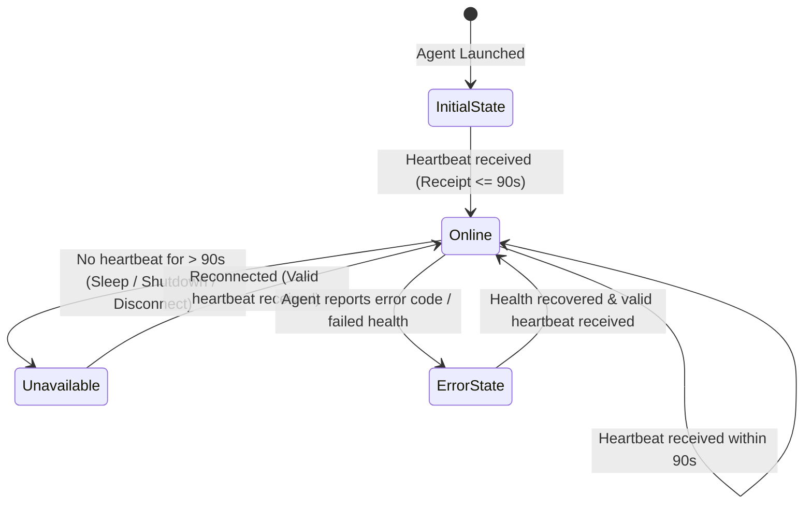

# Jarvis Architecture: Cloud-First AI Companion & Availability Detection

## 1. System Overview

Jarvis is architected with strict separation of concerns between:
1. **Cloud Intelligence Layer** (Hosted on Vercel & Supabase, permanent free tier)
2. **Local Execution Bridge** (Lightweight Python daemon on the laptop, $<100\text{ KB}$ disk footprint)

```
                       +----------------------------------+
                       | Mobile PWA / Browser Client      |
                       | (Microphone, TTS Audio, UI)      |
                       +----------------+-----------------+
                                        |
                             HTTPS / WSS| (PWA Manifest)
                                        v
                       +----------------------------------+
                       | Vercel Serverless Edge API       |
                       |  - Next.js 15 App Router         |
                       |  - Availability Evaluator        |
                       |  - AI Provider Adapter           |
                       +--------+----------------+--------+
                                |                |
                  Auth / RLS /  |                | Server-side API
                  Realtime Sync |                | (Keys never exposed)
                                v                v
       +-------------------------------+   +-----------------------------+
       | Supabase Free Tier            |   | 100% Free AI Providers      |
       | - PostgreSQL (Profiles,       |   | - Google Gemini 1.5 Flash   |
       |   Conversations, Memories,    |   |   (1,500 req/day free)      |
       |   Devices, Command Queue)     |   | - Groq Llama 3.3 70B        |
       | - Row Level Security (RLS)    |   |   (14,400 req/day free)     |
       +---------------+---------------+   +-----------------------------+
                       ^
                       | Outbound Authenticated Polling & Heartbeats
                       | (Zero open inbound laptop ports)
                       v
       +-------------------------------+
       | Lightweight Windows Agent     |
       |  - Python 3.13 Standard Lib   |
       |  - Memory footprint: ~15MB RAM|
       |  - Disk footprint: < 100 KB   |
       |  - Sandboxed Allowlist Only   |
       +-------------------------------+
```

## 2. Laptop Availability Detection & State Machine



### States Defined:
1. **Laptop Online**: Valid authenticated heartbeat received within the last 90 seconds. Commands can be dispatched and executed immediately.
2. **Laptop Unavailable**: Heartbeat is older than 90 seconds. The laptop may be sleeping, powered off, or disconnected from the internet. Cloud chat remains 100% functional; laptop commands are held in `waiting_reconnect` status.
3. **Laptop Agent Error**: Agent sent a heartbeat reporting degraded health or an explicit error code. Safe diagnostic messages are presented to the user.
